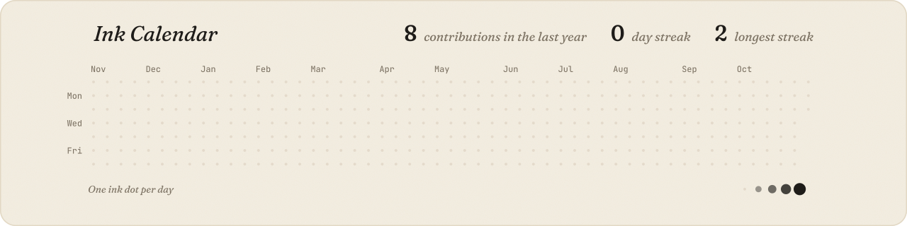

<picture>
  <source media="(prefers-color-scheme: dark) and (prefers-reduced-motion: reduce)" srcset="https://raw.githubusercontent.com/ZH-S-2115/ZH-S-2115/main/assets/hero-dark-still.svg" />
  <source media="(prefers-reduced-motion: reduce)" srcset="https://raw.githubusercontent.com/ZH-S-2115/ZH-S-2115/main/assets/hero-light-still.svg" />
  <source media="(prefers-color-scheme: dark)" srcset="https://raw.githubusercontent.com/ZH-S-2115/ZH-S-2115/main/assets/hero-dark.svg" />
  
</picture>

  
  

A little better every day.

- 正在做 [AXIORA](https://github.com/ZH-S-2115/AXIORA)，一个自托管的多渠道 AI 智能体工作台，把 Agent、Workspace、记忆、工具、渠道和定时任务放进同一个可控的运行环境。
- 关注 AI 产品设计：长期上下文怎么承载，记忆怎么治理，AI 能力怎么做到可见、可控、可验证。
- 欢迎交流 AI 产品、Agent 工作流和自托管软件。

## 作品

### [AXIORA](https://github.com/ZH-S-2115/AXIORA)，自托管的多渠道智能体工作台

<picture>
  <source media="(prefers-color-scheme: dark) and (prefers-reduced-motion: reduce)" srcset="https://raw.githubusercontent.com/ZH-S-2115/ZH-S-2115/main/assets/axiora-dark-still.svg" />
  <source media="(prefers-reduced-motion: reduce)" srcset="https://raw.githubusercontent.com/ZH-S-2115/ZH-S-2115/main/assets/axiora-light-still.svg" />
  <source media="(prefers-color-scheme: dark)" srcset="https://raw.githubusercontent.com/ZH-S-2115/ZH-S-2115/main/assets/axiora-dark.svg" />
  
</picture>

聊天界面让你向 Agent 提问；AXIORA 让 Agent 拥有长期运行的工作区、可审计的能力边界，以及 Web、桌面端和消息渠道共用的运行时。

- 围绕 `Agent → Workspace → Session` 组织信息：每个 Workspace 有自己的文件、Session、Memory、渠道绑定和执行边界，Host 或 Docker 执行。
- Memory 按 Workspace 隔离，记录来源、时间和版本，写入用 revision 与 compare-and-set，并发编辑不会互相覆盖。
- Skills、MCP、Plugins 统一进能力库；运行前计算有效能力清单，路径穿越、越权 Workspace 和未授权能力在边界层拒绝。
- 一套 Web 客户端覆盖 PWA 与 Electron 桌面端，桌面端自带后端运行时，安装即用；飞书、Telegram、QQ、钉钉、微信、Discord、WhatsApp 接入同一个 Agent。

    

## 墨迹

  <picture>
    <source media="(prefers-color-scheme: dark) and (prefers-reduced-motion: reduce)" srcset="https://raw.githubusercontent.com/ZH-S-2115/ZH-S-2115/main/assets/ink-dark-still.svg" />
    <source media="(prefers-reduced-motion: reduce)" srcset="https://raw.githubusercontent.com/ZH-S-2115/ZH-S-2115/main/assets/ink-light-still.svg" />
    <source media="(prefers-color-scheme: dark)" srcset="https://raw.githubusercontent.com/ZH-S-2115/ZH-S-2115/main/assets/ink-dark.svg" />
    
  </picture>

每天由 [.github/workflows/ink.yml](.github/workflows/ink.yml) 根据贡献图重画。上面的图由 [design/build.py](design/build.py) 生成。

---

如果我的项目对你有用，欢迎 star 或提 issue。
